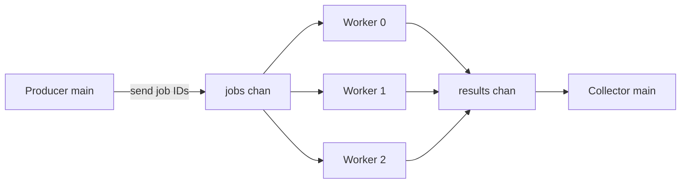

# Go Worker Pool

โปรเจกต์ทดลอง **Go concurrency** สำหรับเรียนรู้ goroutine, Worker Pool, channel, controlled concurrency, backpressure และการส่ง error กลับผ่าน result

สร้างขึ้นแบบ hands-on ทีละขั้น: ส่ง job เข้า channel → worker ดึงงานไปทำแบบ reuse → ส่งผลกลับ collector ผ่าน `JobResult` (สำเร็จหรือล้มเหลว) โดยจำกัดจำนวน worker คงที่แทนการสร้าง goroutine ทีละ job

---

## Architecture and Data Flow

```text
Producer (main)
      │
      ▼
 jobs channel (buffered, capacity 10)
      │
      ├──► Worker 0 ──┐
      ├──► Worker 1 ──┼──► results channel (unbuffered)
      └──► Worker 2 ──┘              │
                                     ▼
                              Collector (main)
                           + JOB SUMMARY print
```



สิ่งสำคัญในโค้ดจริง:

- Worker ทั้ง 3 ตัว **แชร์** `jobs` channel เดียวกัน — job หนึ่งถูก worker หนึ่งตัวรับ ไม่ใช่ broadcast
- แต่ละ worker วนรับงานด้วย `for job := range jobs` จน channel ถูก `close` และค่าที่ค้างถูก drain
- ผลลัพธ์เป็น `JobResult` (JobID, Value, Err) ทั้งกรณีสำเร็จและล้มเหลว
- `sync.WaitGroup` นับ worker ที่ยังทำงาน
- `results` ถูก `close` **หลัง** `wg.Wait()` เท่านั้น (ใน goroutine แยก) เพื่อให้ collector ออกจาก `for range` ได้

---

## Concepts I Learned

### Pool and Queue

| แนวคิด | ความหมายสั้น ๆ |
|--------|----------------|
| Pool | กลุ่ม resource ที่นำกลับมาใช้ซ้ำได้ |
| Worker Pool | ชุด worker goroutine ที่ reuse ได้ (ในโปรเจกต์นี้มี 3 ตัว) |
| Job Queue | คิวงานที่รอ — **ไม่ใช่** Worker Pool |
| Channel | กลไกสื่อสารใน memory ของ Go **ไม่ใช่** durable queue อย่าง database/broker |
| DB connection pool | reuse การเชื่อมต่อ DB ไม่ใช่ HTTP request |

### Goroutine and Concurrency

| หัวข้อ | จุดจำ |
|--------|------|
| `go func()` | สตาร์ท goroutine แยก |
| Runtime | Go runtime จัดการ goroutine ไม่ใช่ 1 OS thread ต่อ 1 goroutine |
| `main()` | **ไม่** รอ goroutine อื่นอัตโนมัติ |
| Concurrency | จัดการหลายงานที่กำลังค้างอยู่พร้อมกัน |
| Parallelism | รันงานพร้อมกันจริงบนหลาย core |
| Threads | สร้างหลาย thread/goroutine **ไม่รับประกัน** ว่าจะ parallel เสมอ |

### WaitGroup

| API | บทบาท |
|-----|--------|
| `Add(n)` | เพิ่มตัวนับตามจำนวน worker ที่จะรอ |
| `Done()` | ลดตัวนับเมื่อ worker จบจริง |
| `Wait()` | บล็อกจนกว่าตัวนับเป็น 0 |
| `defer` | รันก่อนฟังก์ชัน return — ใส่ `defer wg.Done()` ใน worker เพื่อไม่ลืมเรียก |

### Channel and Buffer

| หัวข้อ | จุดจำ |
|--------|------|
| `make(chan int)` | unbuffered — ส่ง/รับต้องพร้อมกัน |
| `make(chan int, n)` | buffered — ส่งได้สูงสุด n ค่าก่อนบล็อก |
| `<-` | ใช้ทั้งส่ง (`ch <- v`) และรับ (`v := <-ch`) |
| `for v := range ch` | รับซ้ำจนกว่า channel ถูก close และว่าง |
| Channel ว่างแต่ยังเปิด | `range` **บล็อก** ไม่จบลูป |
| `close(ch)` | built-in ของ channel; ค่าใน buffer ยังรับได้หลัง close |
| ส่งเข้า closed channel | **panic** |

### Blocking, Backpressure, Deadlock

| คำ | ความหมาย |
|----|----------|
| Blocking | goroutine รอให้ operation ไปต่อได้ |
| Backpressure | consumer ช้า → producer ต้องรอ/ชะลอ (เช่น buffer เต็ม) |
| Deadlock | ทุกฝ่ายรอกันเองแล้วไปต่อไม่ได้ |
| Buffer เต็ม | บล็อกได้ แต่ **ไม่เท่ากับ** deadlock โดยอัตโนมัติ |
| Goroutine บล็อก | ไม่ได้แปลว่าทั้งโปรแกรมต้องหยุดเสมอ |

### Errors and Results

| หัวข้อ | จุดจำ |
|--------|------|
| `(value, error)` | รูปแบบปกติของ Go สำหรับ failure ที่คาดได้ — ไม่ใช่ exception |
| `panic` | ไม่ใช่วิธีรายงาน job fail ทั่วไป |
| `return` / `continue` | จบฟังก์ชัน vs ข้ามรอบลูปปัจจุบัน |
| `struct` | รวมฟิลด์ที่มี type ชัดเจน (คล้าย object shape ใน TypeScript) |
| `JobResult` | ถือ JobID, ค่าที่คำนวณ, และ error |
| Collector | ควรได้รับ outcome ทั้ง success และ failed |

---

## Experiments We Performed

| # | การทดลอง | สิ่งที่เห็น |
|---|-----------|------------|
| 1 | Sequential — 5 jobs | ~5 วินาที (`Sleep` 1s/job) |
| 2 | 1 goroutine ต่อ job | รันพร้อมกัน แต่ main ออกก่อนงานจบถ้าไม่รอ |
| 3 | WaitGroup | main รอจนทุก goroutine จบ |
| 4 | 1 worker + channel | worker เดียวประมวลผล 5 jobs ตามคิว |
| 5 | Pool 3 workers | worker แชร์ channel เดียวกันและ reuse |
| 6 | Backpressure | buffer 0 / 2 / 10 กับ 10 jobs — producer รอเมื่อเต็ม |
| 7 | Worker ID + lifecycle log | `START` ครั้งเดียวต่อ worker; Round หลายครั้ง |
| 8 | Results channel | worker ส่งผลกลับ main |
| 9 | Error simulation | Job 5 fail; job อื่นยังทำต่อ |
| 10 | `JobResult` + summary | 10 outcomes → Success 9 / Failed 1 |

เวลาข้างต้นเป็น illustrative จาก `time.Sleep` ไม่ใช่ benchmark ประสิทธิภาพ CPU

---

## Real Bugs and Lessons

- สตาร์ท goroutine แล้วไม่รอ → `main` จบก่อนงานเสร็จ โปรแกรมออกทันที
- เรียก `wg.Done()` ใน main หลังสตาร์ททันที → ตัวนับลดเร็วเกินไปก่อน worker จบ
- `Add(5)` แต่ `Done()` แค่ 4 ครั้ง → `Wait()` ค้าง = deadlock
- สร้าง worker ภายในลูปส่ง job → ได้ 1 worker ต่อ job แทน pool คงที่
- เรียก worker แบบ sync (ไม่มี `go`) → main ติดรอใน worker ที่ยังรอ job เพิ่ม
- ไม่ `close(jobs)` → `for range jobs` รอตลอด worker ไม่จบ
- พยายาม `close(results)` **หลัง** `for range results` → ลูปรอ close ที่ไม่มีวันมา = deadlock
- ใช้ `panic` เมื่อ job fail → ทั้งโปรแกรมพัง แทนที่จะส่ง error ใน result
- `return` ในสาขา error ของ worker → worker ตายทั้งตัว; ควรข้ามแค่ job นั้น
- `continue` **ก่อน** ส่ง `JobResult` → collector ไม่เห็น outcome ของ job ที่ fail
- `Add(n)` ไม่ตรงจำนวน `Done()` → lifecycle ของ WaitGroup ผิด ทำให้ค้างหรือจบเร็วเกิน

---

## Key Code Patterns

```go
jobs := make(chan int, 10)     // buffered
results := make(chan JobResult) // unbuffered

go func(workerID int) {
    defer wg.Done()
    jobsChan(workerID, jobs, results)
}(id)

for job := range jobs {
    // process one job, then wait for the next
}

go func() {
    wg.Wait()
    close(results) // close only after all workers finish
}()

type JobResult struct {
    JobID int
    Value int
    Err   error
}

value, err := processJob(id)
results <- JobResult{JobID: id, Value: value, Err: err}
```

---

## How to Run and Test

```bash
go run .
go test ./...
go test -race ./...
go vet ./...
go build ./...
```

`go test -race` เปิด **race detector** เพื่อตรวจ data race เมื่อ goroutine หลายตัวอ่าน/เขียน memory ร่วมกันโดยไม่ synchronize

รัน `go run .` จะเห็น log ของ worker + สรุปประมาณ:

```text
========== JOB SUMMARY ==========
Total Jobs : 10
Success    : 9
Failed     : 1
=================================
```

---

## Limitations and Key Takeaways

**ข้อจำกัด**

- เป็นทดลองใน memory — ไม่ persist ลง database หรือ message broker
- จำนวน worker คงที่ (3) ไม่มี dynamic scaling
- `time.Sleep` จำลองงาน ไม่ใช่ I/O จริง
- ลำดับจบของ job **ไม่รับประกัน**
- ขนาด buffer ≠ จำนวน worker; buffer ใหญ่ขึ้นไม่ทำให้ worker เร็วขึ้นเอง
- ระบบจริงอาจต้องมี cancellation, timeout, retry, graceful shutdown — **ยังไม่ได้ implement** ในโปรเจกต์นี้

**Takeaways สั้น ๆ**

1. Worker Pool = จำกัด concurrency ด้วย goroutine ที่ reuse + แชร์ job channel
2. Channel คือคิวใน memory; buffer ควบคุม backpressure ไม่ใช่ความเร็วของ worker
3. ปิด channel ถูกฝั่ง/ถูกจังหวะ — และปิด `results` หลัง `WaitGroup` เท่านั้น
4. ส่ง outcome ทุก job ผ่าน struct + `error`; อย่า `panic` / `return` ทิ้ง worker เมื่อเจอ fail ที่คาดได้
5. Concurrency ต้องออกแบบ lifecycle ให้ชัด — ไม่รอ / Done ผิดที่ / close ผิดลำดับ มักจบที่ deadlock หรือผลหาย
